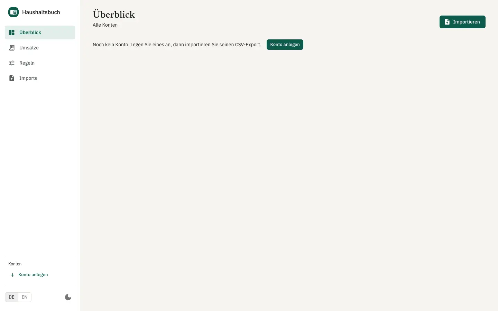
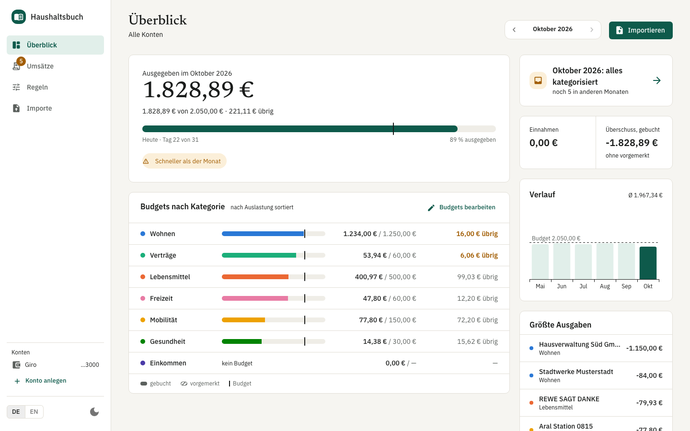
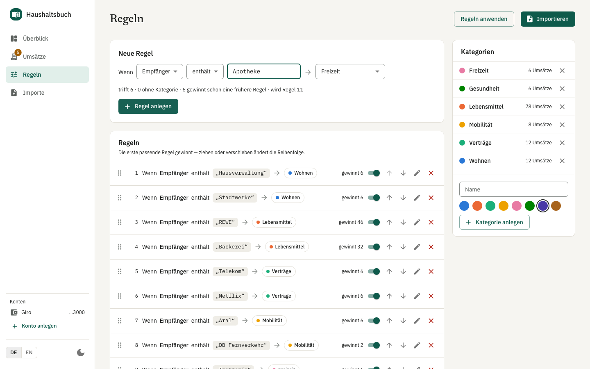
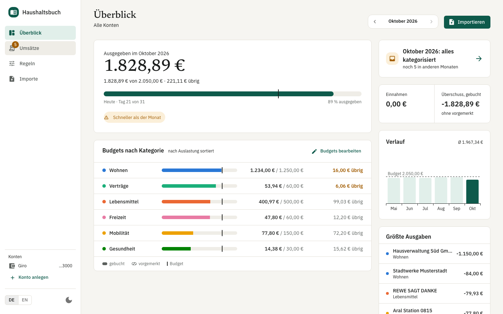
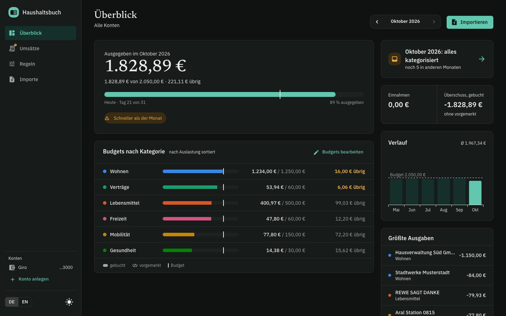
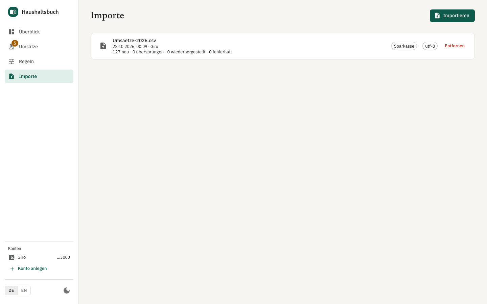
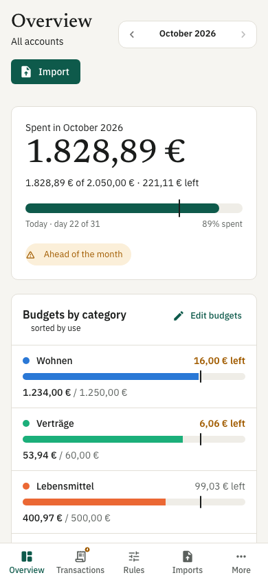

# household-budget

[](https://github.com/ramazankarisan/household-budget/actions/workflows/ci.yml)
[](LICENSE)

A local-first household budget app for German bank exports. Drop in a Sparkasse or Deutsche Bank
CSV, and it sorts every transaction into a category by rules you write, then shows each month's
spending per category against a limit. Your bank history stays on your machine, in SQLite;
nothing is uploaded anywhere.



<sub>All screenshots use synthetic data generated by `pnpm docs:images`, never a real statement.</sub>

## What it does

1. **Import.** Upload a bank's CSV export. The bank and the encoding are detected from the file,
   never asked. Overlapping exports import only what is new, even two identical coffees on the
   same day. A bad row is reported by line number while the rest imports, and every upload can
   be undone.
2. **Categorize.** Rules read as sentences: _Wenn Empfänger enthält „Bäckerei“ → Lebensmittel_.
   The first matching rule wins. It finds `BAECKEREI SCHMIDT` too, and a live preview counts what
   a rule will reach before you save it. A category you set by hand is never overwritten.
3. **Report.** For each month: spending per category against its limit, the pace against the
   calendar, what is still unsorted, and a six-month trend.

The UI is German with an English switch, light and dark, and works from 390 px up.

## What this project shows

A small product, built carefully. These are the parts worth a reviewer's time:

- **Correctness where money is involved.** Amounts are integer cents from the CSV text onward,
  never floats. Dates have no time zone. Deduplication across overlapping exports is
  fingerprint-based and keeps genuinely identical rows apart. The same rule engine runs on the
  server and in the browser preview, so both always agree
  ([`packages/core`](packages/core)).
- **Private by design, not by policy.** There is no account system because the API only answers
  on loopback, behind a Host/Origin guard. A security review found and closed the LAN exposure
  ([report](docs/reports/2026-09-24-security-review.html)).
- **Tests that prove something.** Unit and property tests (fast-check), weekly mutation testing
  (Stryker, ≥ 81 %), Playwright end-to-end with axe accessibility checks in both themes, and
  coverage ratchets. Architecture boundaries are enforced as rules (dependency-cruiser): core
  can never import a framework.
- **AI-assisted, with backpressure.** It was built with Claude Code as the implementing agent:
  research → plan → implement, with every decision written down ([11 plans](docs/plans),
  [7 research notes](docs/research)). The agent works under gates it cannot skip. Hooks refuse
  `--no-verify` and any read of real bank data, a Stop hook runs the checks before it may say
  "done", and CI repeats everything. Code review, dogfooding and security-review sessions then
  found what the tests didn't. The full story is in
  [docs/best-practices.md](docs/best-practices.md).

**Stack:** TypeScript 6 · React 19 + MUI 9 + Vite · NestJS 12 · Prisma 7 + SQLite · Vitest ·
Playwright · pnpm workspaces.

## Screenshots

|                                                |                                                                        |
| ---------------------------------------------- | ---------------------------------------------------------------------- |
|          |                    |
|        |                |
|  |  |

## Run it locally

You need macOS or Linux, **Node 24** (`nvm install` reads `.nvmrc`) and **pnpm** (`corepack enable`).

```bash
pnpm install
```

```bash
cp apps/api/.env.example apps/api/.env
```

```bash
pnpm --filter @household-budget/api db:push
```

```bash
pnpm dev
```

Open http://localhost:5173. Create an account with the IBAN `DE89370400440532013000`, then drop
`fixtures/sparkasse-camt-18.csv` on the window. Both fixtures are synthetic exports.

Committing needs `gitleaks` (`brew install gitleaks`). End-to-end tests need
`pnpm e2e:install` once. After a schema change, run `db:push` again; it adds columns without
touching your rows.

## Checks

| Command            | What it runs                                                                              |
| ------------------ | ----------------------------------------------------------------------------------------- |
| `pnpm check`       | format, lint, architecture rules, unused code, duplication, typecheck, unit tests (~20 s) |
| `pnpm check:all`   | the above plus Playwright against a real API and browser — what CI runs                   |
| `pnpm mutation`    | Stryker over `packages/core`; CI runs it weekly                                           |
| `pnpm docs:images` | regenerates every image in this README from synthetic data                                |

## Further reading

- [Architecture](docs/architecture.md): boundaries, data flow, and what was deliberately not chosen
- [Best practices](docs/best-practices.md): the agent workflow and its six layers of gates
- [DESIGN.md](DESIGN.md): the UI rulebook every screen is checked against
- [Plans](docs/plans), [research](docs/research), [reports](docs/reports): every feature's
  decisions, and the reviews that tested them

## License

[MIT](LICENSE)
